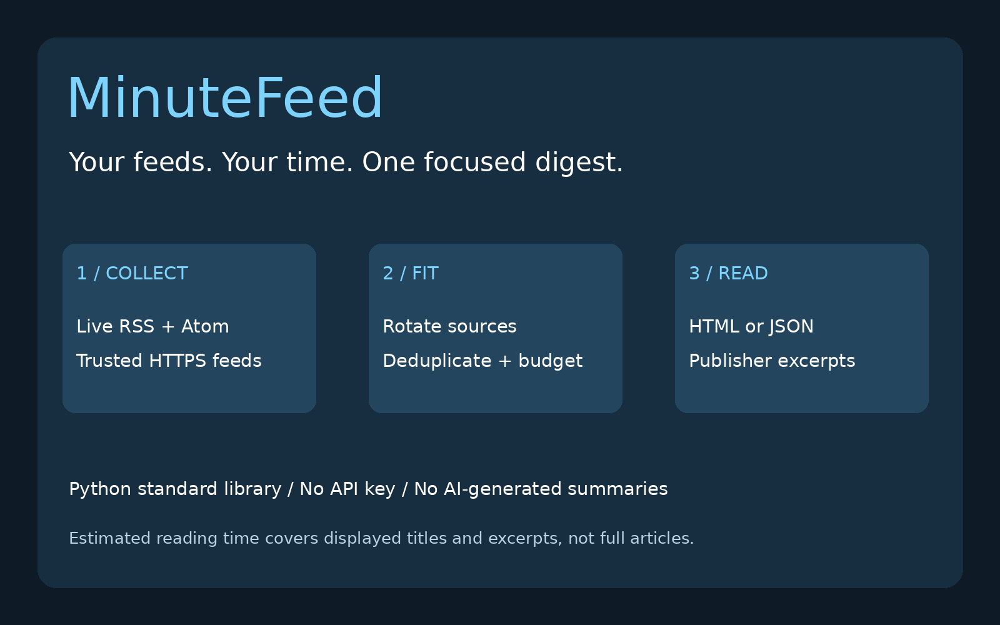
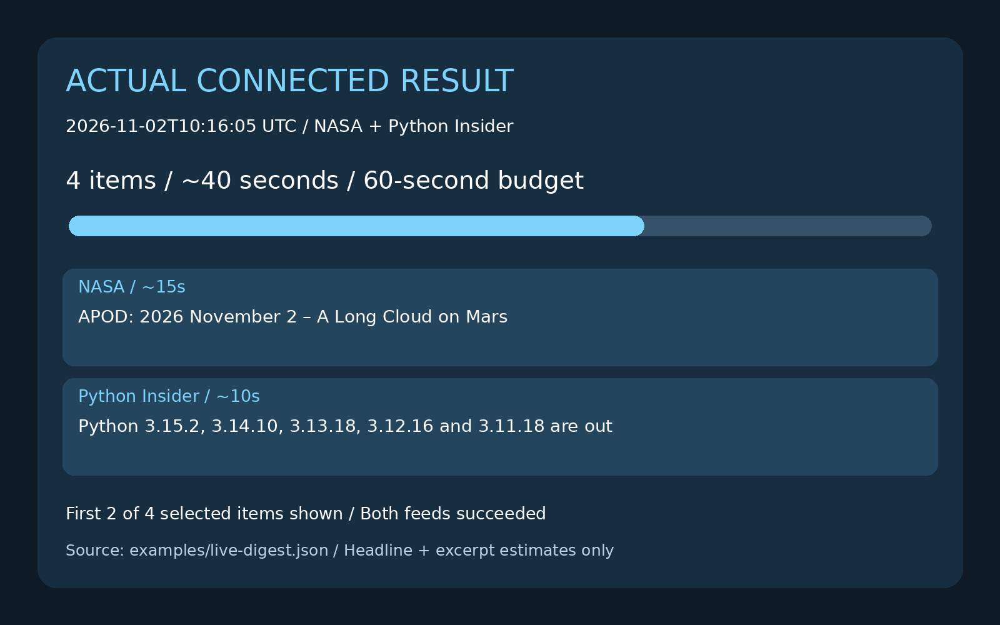

# MinuteFeed

    



**Your feeds, a reading budget, one focused digest.**

An unread feed queue can grow faster than your available time. MinuteFeed fetches RSS/Atom sources and builds a small digest under an estimated reading-time budget. It rotates between sources, removes repeated article links and exports a self-contained HTML page or JSON. Useful for a morning scan, a team reading list or a short study break.

It displays publisher-provided excerpts; it does not generate AI summaries or fetch linked articles.

## Features

- Live RSS 2.0 and Atom 1.0 input from 1–5 trusted public HTTPS URLs.
- Adjustable minutes, estimated words per minute and maximum number of items.
- Round-robin selection preserves each source's feed order without letting one source consume every initial slot.
- Deduplication after removing fragments and common tracking parameters (`utm_*`, `fbclid`, `gclid`, `msclkid`).
- Bounded titles/excerpts, plain-text markup cleanup and escaped HTML; no remote images, JavaScript or analytics.
- Explicit partial-result status when a source fails.
- Serial requests with timeouts, a 1 MB response cap, no redirects and no automatic retries.
- No API key, account, paid service or third-party Python runtime dependency.

## Installation

Python 3.10+ with standard-library HTTPS support is required.

```bash
git clone https://github.com/dxrkf/minutefeed.git
cd minutefeed
python minutefeed.py --help
```

## Usage

Create a one-minute scan with up to four items:

```bash
python minutefeed.py \
  https://www.nasa.gov/feed/ \
  'https://blog.python.org/feeds/posts/default?alt=rss' \
  --minutes 1 --max-items 4 --html digest.html
```

Open `digest.html` in your browser. The file is static and works without a connection after generation; fetching fresh sources requires the internet.

Export the same digest as JSON in the same run:

```bash
python minutefeed.py https://www.nasa.gov/feed/ \
  'https://blog.python.org/feeds/posts/default?alt=rss' \
  --minutes 1 --max-items 4 --json --html digest.html > digest.json
```

### Actual connected result

The two-source command above succeeded on **2 November 2026 at 13:16 Arabia Standard Time (10:16 UTC)**. It produced **4 items with an estimated 40 seconds of reading**, within a 60-second budget. Both sources returned successfully; `partial` was `false`. The four-item cap excluded 56 further unique candidates; the selected candidates needed no budget exclusions in this particular run.

```json
{
  "format": "minutefeed-v1",
  "budget_seconds": 60,
  "estimated_seconds": 40,
  "words_per_minute": 200,
  "duplicates_removed": 0,
  "skipped_budget": 0,
  "skipped_item_limit": 56,
  "partial": false
}
```

Full captured outputs: [live-digest.json](examples/live-digest.json) and [live-digest.html](examples/live-digest.html). Download the HTML and open it locally; GitHub may show source text. Future runs will differ as feeds change.



## Options and exit status

| Option | Range | Default |
| --- | --- | --- |
| `--minutes` | 1–30 | 3 |
| `--wpm` | 50–600 | 200 |
| `--max-items` | 1–50 | 12 |
| `--timeout` | 1–60 seconds per feed | 25 |
| `--html PATH` | Explicit output file | No file |
| `--json` | Print JSON instead of terminal digest | Off |

Exit `0`: all feeds were parsed successfully, including a digest with zero selected items. Exit `2`: invalid settings/output or at least one unavailable/unsupported feed. Partial JSON/HTML can still contain useful items; inspect `partial` and the per-feed status. Empty input feeds are not automatically treated as failures.

HTML is replaced atomically, and output symlinks are refused. If settings or output fail, an older HTML file may remain; inspect its generation timestamp. Shell `>` can truncate an existing JSON file even if the command fails. Use a temporary destination and inspect exit status before replacing a previous JSON digest.

## How selection works

1. Parse up to 50 entries per source in the order supplied by the feed. Titles are capped at 180 characters and excerpts at 240.
2. Rotate through sources, considering one candidate per source per round. Skip entries without a usable title and HTTPS link.
3. Normalize links and keep the first occurrence of each resulting URL.
4. Estimate reading time from displayed title and excerpt text. Use a minimum five-second scan allowance per item; count CJK characters individually and other word-like runs approximately.
5. Include an item only if it fits the remaining time and item count. Continue considering shorter later items when an earlier item does not fit.

The sum of the **estimates** stays within the budget. Actual human reading time is not guaranteed. Estimates exclude source labels, interface text and linked full articles. This is a greedy scan, not an optimal knapsack solver, personalized ranking or a guarantee of equal source representation. Identical stories with different URLs can remain; a repeated URL uses the first source's title/excerpt. Query ordering and meaningful query parameters are preserved; removing tracking parameters can affect signed or unusual links.

## Network, privacy and cost

Every run makes at most one HTTPS request per distinct supplied feed URL, serially. No linked article, image or external entity is fetched. There is no background worker, scheduler, email, push notification, API key or paid resource.

Feed providers see your network address and requested URL. Supply public demo feeds or sources you are comfortable requesting; avoid private feed tokens or credentials. The tool records feed URLs in its report, so review output before sharing it. Public publisher policies and rate limits apply. Run infrequently, respect their terms, and wait before retrying a 429 or temporary outage. There is no cached fallback or uptime guarantee.

## Limits

- Supports **UTF-8 RSS 2.0 and Atom 1.0**, not RSS 1.0/RDF, JSON Feed, OPML or authenticated feeds. DTD/entity declarations are rejected; other XML encodings are unsupported.
- Redirects are refused. Use the final public HTTPS feed URL. URLs with credentials, non-443 ports, local hostnames and private literal IPs are rejected.
- Designed as a local CLI for trusted feed lists. Hostname validation is not DNS pinning or a complete SSRF boundary; do not expose it as a server accepting arbitrary remote URLs.
- No publication-date filtering or cross-source chronological sort; feed order may include old or pinned posts. The generation timestamp is not an article publication date.
- No read/unread history, semantic deduplication, article extraction, automatic summarization or relevance scoring. Missing descriptions produce title-only cards.
- Publisher markup is reduced to text and may lose formatting. Unsupported/malformed feeds produce an explicit partial result.
- Source content and headlines belong to their respective owners. MIT covers this tool's code, not publisher content. Review source terms before redistributing digests.

Sources and format references: [NASA RSS directory](https://www.nasa.gov/rss-feeds/), [Python Insider](https://blog.python.org/), [Atom specification, RFC 4287](https://www.rfc-editor.org/rfc/rfc4287.html). The demo uses public feeds and contains no user's reading history.

## Tests

```bash
python -m unittest -v
```

23 deterministic tests verify RSS/Atom parsing, markup cleanup, excerpt bounds, HTTPS URL checks, query preservation, tracking cleanup, unsafe/missing links, DTD rejection, feed/item caps, source rotation, duplicates, time budgets, shorter-item continuation, CJK estimates, invalid settings, partial results, response limits, network/429/redirect errors, HTML escaping, CLI failure status and atomic/symlink output behavior. Tests inject responses and do not access the network. The captured example was separately generated with real HTTPS requests to both demo sources.

## Topics

`rss` `atom` `feed-reader` `productivity` `python` `cli` `reading` `digest`

Code license: MIT. Arabic/English post drafts: [POST.md](POST.md).
